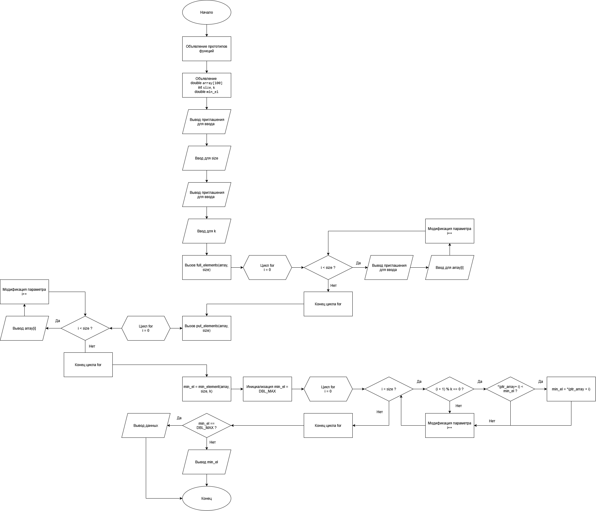

# Домашнее задание к работе 14

## Условие задачи
Каждый вариант оформить в виде отдельной функции, которая возвращает найденного значение и принимает в качестве аргументов – указатель на массив, его размер и необходимые для условий поиска параметры.
Поиск минимального значения, среди элементов порядковый номер которых кратен К.

## 1. Алгоритм и блок-схема

### Алгоритм
1. **Начало**
2. Объявление прототипов функций
3. Объявление массива
   - double `array[100]` - массив
4. Объявление переменных
   - int `size`, `k` - размер массива, k из условия
   - double `min_el` - минимальное значение
5. Вывод приглашение для ввода
6. Ввод `size`
7. Вывод приглашение для ввода
8. Ввод `k`
9. Вызов full_elements(`array`, `size`)
    - Функция заполняет массив данными пользователя
    - Принимает double* `ptr_array`, int `size` - указатель на массив, размер
    - Возвращает `ptr_array` - указатель на массив
10. Вызов put_elements(`array`, `size`)
    - Функция выводит элементы массива
    - Принимает double* `ptr_array`, int `size` - указатель на массив, размер
    - Возвращает void
11. min_el = min_element(array, size, k)
    - Функция находит минимальное значение, среди элементов порядковый номер которых кратен К
    - Принимает double* `ptr_array`, int `size`, int `k` - указатель на массив, размер, k из условия
    - Возвращает min_el - минимальный элемент, среди элементов порядковый номер которых кратен К
12. Условный оператор if-else
    - if (min_el == DBL_MAX)
    - Вывод данных
    - else вывод `min_el`
13. **Конец**

### Блок-схема
 

## 2. Реализация программы

```
#define _CRT_SECURE_NO_WARNINGS
#include <stdio.h>
#include <locale.h>
#include <float.h>

double* full_elements(double* ptr_array, int size);
void put_elements(double* ptr_array, int size);
double min_element(double* ptr_array, int size, int k);

int main(void) {
	setlocale(LC_CTYPE, "RUS");

	double array[100];
	int size, k;
	double min_el;

	printf("Введите размер массива (до 100): ");
	scanf("%d", &size);
	printf("\n");

	printf("Введите число k: ");
	scanf("%d", &k);
	printf("\n");

	full_elements(array, size);
	put_elements(array, size);

	min_el = min_element(array, size, k);

	if (min_el == DBL_MAX) printf("Ничего не найдено\n");
	else printf("%f", min_el);

	return 0;
}

double* full_elements(double* ptr_array, int size) {
	
	for (int i = 0; i < size; i++) {
		printf("Введите %d элемент массива: ", i + 1);
		scanf("%lf", (ptr_array + i));
		printf("\n");
	}

	return ptr_array;
}

void put_elements(double* ptr_array, int size) {

	for (int i = 0; i < size; i++) printf("%d элемент массива: %f\n", i + 1, *(ptr_array + i));
	
}

double min_element(double* ptr_array, int size, int k) {

	double min_el = DBL_MAX;
	
	for (int i = 0; i < size; i++) {

		if ((i + 1) % k == 0) {

			if (*(ptr_array + i) < min_el) min_el = *(ptr_array + i);

		}
	}

	return min_el;
}
```

## 3. Результаты работы программы

```
Введите размер массива (до 100): 10

Введите число k: 4

Введите 1 элемент массива: 1

Введите 2 элемент массива: 2

Введите 3 элемент массива: 3

Введите 4 элемент массива: 4

Введите 5 элемент массива: 5

Введите 6 элемент массива: 6.47474

Введите 7 элемент массива: 737

Введите 8 элемент массива: 8.0000

Введите 9 элемент массива: 90

Введите 10 элемент массива: 10

1 элемент массива: 1.000000
2 элемент массива: 2.000000
3 элемент массива: 3.000000
4 элемент массива: 4.000000
5 элемент массива: 5.000000
6 элемент массива: 6.474740
7 элемент массива: 737.000000
8 элемент массива: 8.000000
9 элемент массива: 90.000000
10 элемент массива: 10.000000
4.000000
```

## 4. Информация о разработчике

Лупачев Сергей бТИИ-262
